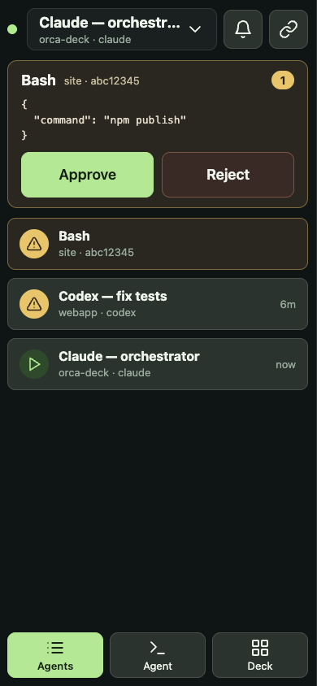
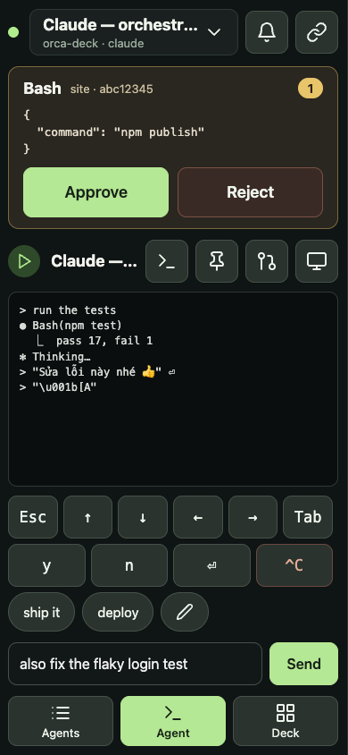
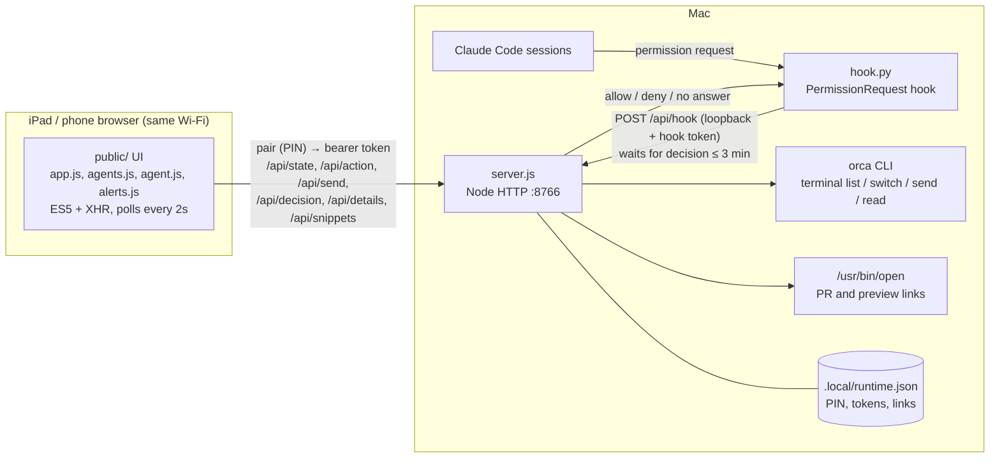

# Orca Deck

A control deck for Orca agent terminals that runs in the browser of an iPad, phone or any device on your home Wi‑Fi (tested target: iPad mini 3 / iOS 12.5.8 Safari). See every agent at a glance, read and reply to one, approve or reject Claude Code permission requests, and get a chime when an agent needs you. No app install, no dependencies, and nothing leaves your local network.

| Deck (iPad) | Agents (phone) | Agent (phone) |
|---|---|---|
|  |  |  |

## Architecture



- **server.js** serves the UI and a small JSON API. It holds pending permission requests in memory only and controls terminals through the `orca` CLI.
- **hook.py** is a Claude Code `PermissionRequest` hook. It forwards each request to the server and blocks until you tap Approve or Reject on the iPad. If the deck isn't open, the server isn't running, or 3 minutes pass, it returns nothing and Claude falls back to its normal in-terminal prompt.
- **public/** is the UI: plain HTML, CSS and ES5 JavaScript so it runs on iOS 12. `app.js` is the shell and Deck view; `agents.js`, `agent.js` and `alerts.js` add the Agents view, the Agent view and alerts.

## Requirements

- macOS with [Node.js](https://nodejs.org) 18+ and the system `/usr/bin/python3`
- Orca with its CLI at `~/.local/bin/orca` (override with `ORCA_CLI_COMMAND`)
- Claude Code and/or Codex running in Orca terminals
- An iPad (or any browser) on the same trusted Wi‑Fi network

## Setup

1. Double-click `Start.command` (or run `npm start`) and keep that window open. Only run one copy.
2. Pair the iPad. Double-click `Ghép-thiết-bị.command` ("pair device"), or open `http://127.0.0.1:8766/pair` on the Mac, and scan the QR code with the iPad camera. The QR holds a one-time link that expires in 5 minutes, so it never contains the pairing code itself. The page only opens on the Mac.

   Or type it by hand: open the **"Trên iPad"** ("on iPad") address printed in the window (the server console is in Vietnamese), e.g. `http://192.168.1.20:8766`, and enter the 8-digit pairing code shown in the same window and on the pairing page. The address can change when the Mac changes networks.
3. On iOS, a Home Screen app keeps its own storage, so after Add to Home Screen it asks to pair again: open the pairing page and use the code.
4. Tap the agent bar at the top (or the **Agent** key), then tap the pin icon next to the Claude session you use as your orchestrator. The **Main Claude** key always brings that session to the front on the Mac.
5. Tap the link icon to save a PR URL and a preview URL for the current project. The **PR** / **Preview** keys open them in the Mac's default browser (including `http://localhost:3000`).
6. Install the approval hook (it keeps your existing hooks and settings and backs up `settings.json` first):

   ```sh
   /usr/bin/python3 install-hook.py
   ```

   New Claude Code sessions pick it up automatically. In an older session, check `/hooks`. To uninstall, double-click `Gỡ-hook.command` (or run `install-hook.py --uninstall`); only the Orca Deck hook is removed.

**Run at login (optional):** double-click `Tự-khởi-động.command` ("auto-start"), or run `/usr/bin/python3 install-autostart.py`. It installs a LaunchAgent that starts the deck when you log in and restarts it if it stops; output goes to `.local/deck.log`. Close any `Start.command` window first, since only one copy can run. To remove it, double-click `Gỡ-tự-khởi-động.command` or run `install-autostart.py --uninstall`.

Tip: In Safari, use Share → Add to Home Screen for a full-screen app with the Orca Deck icon, and turn off Auto-Lock to keep the deck visible. Landscape shows 4×2 keys and portrait shows 2×4.

## Using the deck

**Tabs:** **Agents**, **Agent** and **Deck**. They sit at the bottom on narrow screens and at the top on wide ones. Phones open on Agents, tablets on Deck; the last tab you used is remembered per device.

**Top bar:** connection dot, the selected agent (tap to switch), sound on/off, links, and layout edit (Deck only).

**Approval card:** appears on every tab while Claude is waiting; on Agents and Agent it has its own Approve and Reject buttons. It shows the tool, project, session ID and the exact input. With more than one request, pick one from the list. Selecting a terminal and selecting a request are separate on purpose: a project can run several Claude sessions, so the deck never guesses which session a request belongs to.

| Key | What it does |
|---|---|
| **Approve** | Allows the selected request **once**. Never creates an "always allow" rule. |
| **Reject** | Denies the selected request. |
| **Continue** | Types `continue` + Enter into the selected agent, only if its terminal is idle and no approval prompt is on screen. |
| **Interrupt** | Sends an interrupt to the selected agent through Orca. |
| **Main Claude** | Focuses your pinned orchestrator session on the Mac. |
| **Agent** | Lists running Claude/Codex terminals; tap one to focus it on the Mac, or pin a Claude session. |
| **PR / Preview** | Opens the project's saved link on the Mac (HTTP/HTTPS only). |

**Agents tab:** every Claude/Codex terminal with its status (needs approval, working, idle) and how long since its last output, with pending Claude requests listed first. Tap an agent to open it.

**Agent tab:** the agent's live screen (refreshed every 2 seconds). Your messages are highlighted, AI replies are bright, and tool output is dimmed (from the `❯`/`⏺`/`⎿` marks Claude Code draws, and `›`/`•` for Codex). **Fit** keeps each terminal row on one line and shrinks the text to the screen width so tables stay aligned (down to 9px, then it scrolls sideways); **Wrap** wraps long lines instead. **Hide keys** gives the screen the full height. Both choices are saved per device. Below the screen: a key row (Esc, arrows, Tab, y, n, Enter, Ctrl‑C), saved replies and a reply box. Tap a saved reply to put it in the box; the pencil edits the list, which is shared by all your devices. The header buttons show the agent on the Mac, pin it as Main Claude, and open its PR or preview. Typing is blocked while the screen shows an approval prompt or a Claude request is pending for that project; Ctrl‑C always works. If a send times out, the deck says it might have been sent and waits for a fresh screen before letting you send again.

**Alerts** (while the deck is open): a chime, an amber flash and a count in the page title when an agent needs you, and a softer chime and green flash when a busy agent goes quiet (its output stopped, which doesn't always mean it finished). The bell mutes sound. iOS only plays sound after you've tapped the page once. Vibration works on Android only.

**Edit layout** (grid icon): tap a key, then use ‹ › to move it, the eye to hide or show it, ↺ to reset, and **Done** to save. The layout is stored in the browser on that device. The unpair button is also here, so it's hard to hit by accident.

**Language:** the UI is available in English and Vietnamese. It follows the device language on first open; switch with the globe button on the pairing screen or in edit layout. The choice is saved on that device, and server error messages follow it too. To add a language, add a block to `TEXT` in `public/app.js` and to `EN`-style messages in `server.js`.

## Security

- Use only on a trusted local network. Traffic is plain HTTP; never expose port 8766 to the internet.
- The iPad pairs with a one-time-shown 8-digit PIN (5 attempts per minute) and then uses a bearer token. The hook uses a separate token and is only accepted from loopback. Requests are checked for host and origin, and a strict CSP is set.
- Every terminal action re-checks the terminal's incarnation ID, so a command is never sent to a process that replaced the one you selected.
- Anyone paired can type into your agents. Pair only your own devices.
- The deck answers on every network interface of the Mac, including VPNs. Keep the Mac off routed VPNs while it runs, or block port 8766 there.
- The deck checks the screen right before typing, but a prompt that appears in the split second between the check and the keystroke could receive it.
- Permission requests live only in memory. No transcripts or commands are written to disk.
- `.local/` holds the PIN and tokens for this Mac. Don't share or commit it (it's gitignored).

## Limitations

- Only Claude Code approvals go through the hook. Codex terminals support focus, Continue, Interrupt and the Agent tab, but Codex approvals stay on the Mac (the deck blocks typing while one is on screen).
- Claude's sandbox network prompts and some special dialogs still need the Mac.
- Without the auto-start option, closing the server window stops the deck.
- No alerts when the deck is closed or the device is locked. Web push needs HTTPS and iOS 16.4+, so it can't reach an iPad mini 3.

## Development

```sh
npm test
```

No packages to install. Tests replace only the `orca` CLI boundary with a fake.

Claude Code hook docs: https://code.claude.com/docs/en/hooks#permissionrequest
