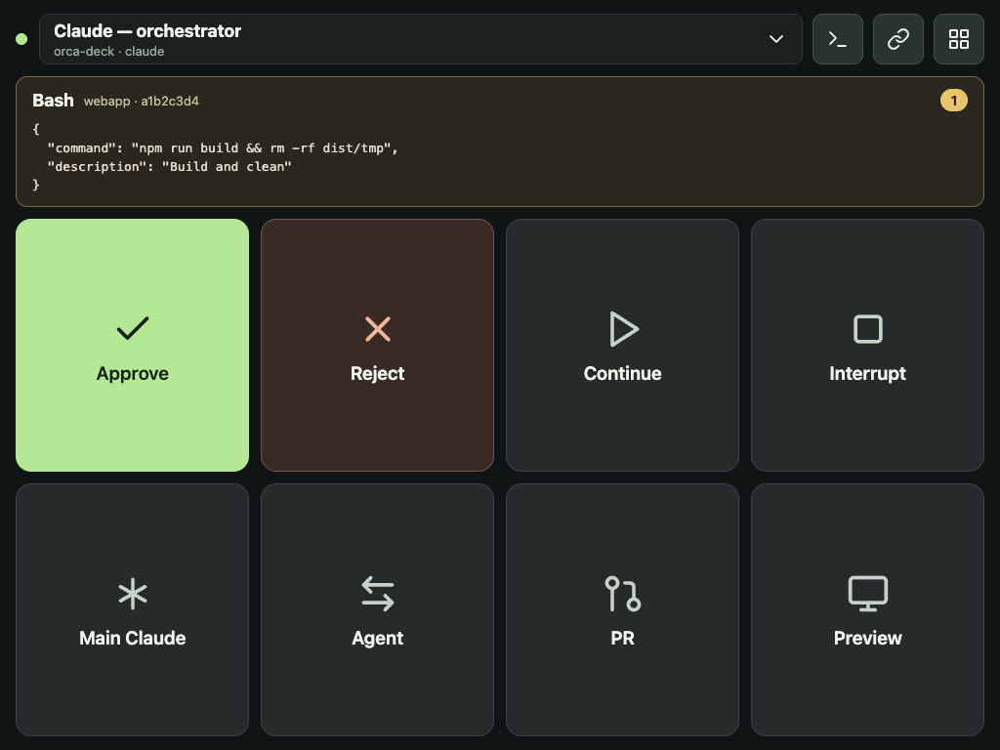
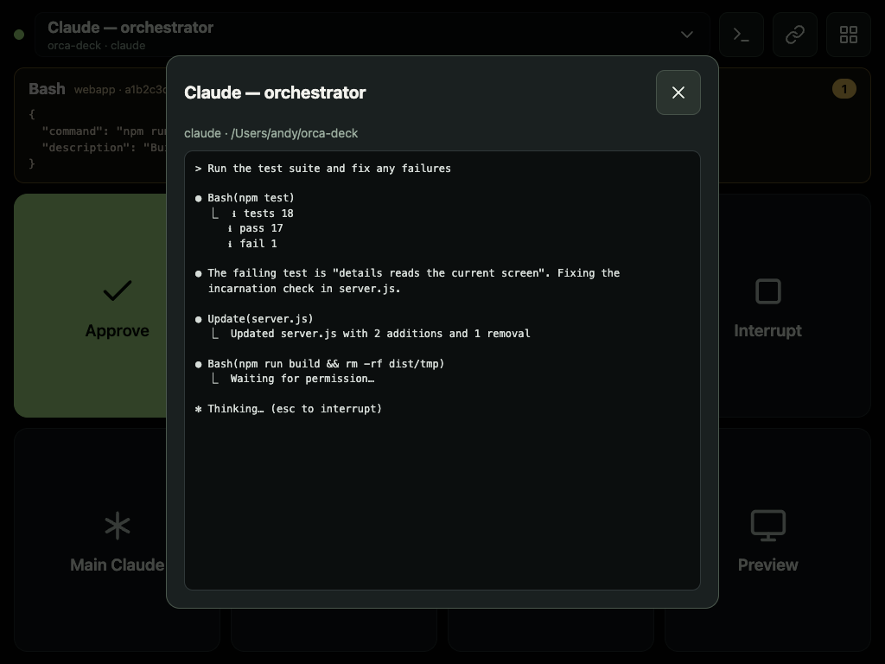
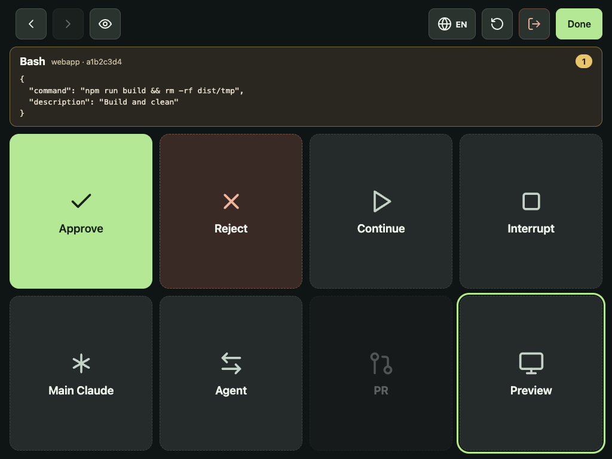
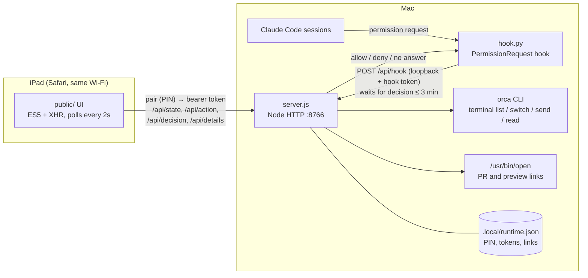

# Orca Deck

A one-screen control deck for Orca agent terminals, built for an old iPad (tested target: iPad mini 3 / iOS 12.5.8 Safari). Approve or reject Claude Code permission requests, nudge agents, and open PRs/previews on your Mac, all from a tablet sitting next to it. No app install, no dependencies, and nothing leaves your local network.

| Deck | Session details | Edit layout |
|---|---|---|
|  |  |  |

## Architecture



- **server.js** serves the UI and a small JSON API. It holds pending permission requests in memory only and controls terminals through the `orca` CLI.
- **hook.py** is a Claude Code `PermissionRequest` hook. It forwards each request to the server and blocks until you tap Approve or Reject on the iPad. If the deck isn't open, the server isn't running, or 3 minutes pass, it returns nothing and Claude falls back to its normal in-terminal prompt.
- **public/** is the iPad UI: plain HTML, CSS and ES5 JavaScript so it runs on iOS 12.

## Requirements

- macOS with [Node.js](https://nodejs.org) 18+ and the system `/usr/bin/python3`
- Orca with its CLI at `~/.local/bin/orca` (override with `ORCA_CLI_COMMAND`)
- Claude Code and/or Codex running in Orca terminals
- An iPad (or any browser) on the same trusted Wi‑Fi network

## Setup

1. Double-click `Start.command` (or run `npm start`) and keep that window open. Only run one copy.
2. On the iPad, open the **"Trên iPad"** ("on iPad") address printed in the window (the server console is in Vietnamese), e.g. `http://192.168.1.20:8766`. It can change when the Mac changes networks.
3. Enter the 8-digit pairing code from the same window. The code is only shown there; the API never returns it.
4. Tap the agent bar at the top (or the **Agent** key), then tap the pin icon next to the Claude session you use as your orchestrator. The **Main Claude** key always brings that session to the front on the Mac.
5. Tap the link icon to save a PR URL and a preview URL for the current project. The **PR** / **Preview** keys open them in the Mac's default browser (including `http://localhost:3000`).
6. Install the approval hook (it keeps your existing hooks and settings and backs up `settings.json` first):

   ```sh
   /usr/bin/python3 install-hook.py
   ```

   New Claude Code sessions pick it up automatically. In an older session, check `/hooks`. To uninstall, double-click `Gỡ-hook.command` (or run `install-hook.py --uninstall`); only the Orca Deck hook is removed.

Tip: In Safari, use Share → Add to Home Screen for a full-screen app, and turn off Auto-Lock to keep the deck visible. Landscape shows 4×2 keys and portrait shows 2×4.

## Using the deck

**Top bar:** connection dot, the selected agent (tap to switch), session details, links, and layout edit.

**Approval card:** appears only while Claude is waiting. It shows the tool, project, session ID and the exact input. With more than one request, pick one from the list. Selecting a terminal and selecting a request are separate on purpose: a project can run several Claude sessions, so the deck never guesses which session a request belongs to.

| Key | What it does |
|---|---|
| **Approve** | Allows the selected request **once**. Never creates an "always allow" rule. |
| **Reject** | Denies the selected request. |
| **Continue** | Types `continue` + Enter into the selected agent, only if its terminal is idle and no approval prompt is on screen. |
| **Interrupt** | Sends an interrupt to the selected agent through Orca. |
| **Main Claude** | Focuses your pinned orchestrator session on the Mac. |
| **Agent** | Lists running Claude/Codex terminals; tap one to focus it on the Mac, or pin a Claude session. |
| **PR / Preview** | Opens the project's saved link on the Mac (HTTP/HTTPS only). |

**Session details** (terminal icon): shows the selected agent's workspace and its current terminal screen, refreshed every 2 seconds while open. Use it to see what an agent is doing before you approve or continue.

**Edit layout** (grid icon): tap a key, then use ‹ › to move it, the eye to hide or show it, ↺ to reset, and **Done** to save. The layout is stored in the browser on that device. The unpair button is also here, so it's hard to hit by accident.

**Language:** the UI is available in English and Vietnamese. It follows the device language on first open; switch with the globe button on the pairing screen or in edit layout. The choice is saved on that device, and server error messages follow it too. To add a language, add a block to `TEXT` in `public/app.js` and to `EN`-style messages in `server.js`.

## Security

- Use only on a trusted local network. Traffic is plain HTTP; never expose port 8766 to the internet.
- The iPad pairs with a one-time-shown 8-digit PIN (5 attempts per minute) and then uses a bearer token. The hook uses a separate token and is only accepted from loopback. Requests are checked for host and origin, and a strict CSP is set.
- Every terminal action re-checks the terminal's incarnation ID, so a command is never sent to a process that replaced the one you selected.
- Permission requests live only in memory. No transcripts or commands are written to disk.
- `.local/` holds the PIN and tokens for this Mac. Don't share or commit it (it's gitignored).

## Limitations

- Only Claude Code approvals go through the hook. Codex terminals support focus, Continue, Interrupt and details, but Codex approvals stay on the Mac.
- Claude's sandbox network prompts and some special dialogs still need the Mac.
- Closing the server window stops the deck; it doesn't start at login.

## Development

```sh
npm test
```

No packages to install. Tests replace only the `orca` CLI boundary with a fake.

Claude Code hook docs: https://code.claude.com/docs/en/hooks#permissionrequest
